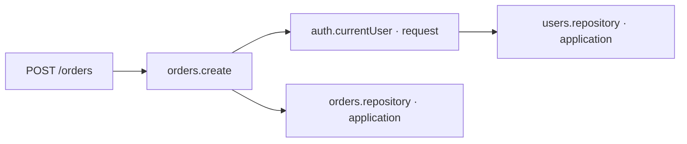

# Як влаштований ARC

[← Зміст](README.md)

## Основні сутності

| Сутність              | Роль                                                         | Функція                               |
| --------------------- | ------------------------------------------------------------ | ------------------------------------- |
| Contract              | Runtime-перевірка input/output та виведення TypeScript-типів | `s.object`, `s.string` тощо           |
| Operation             | Один сценарій бізнес-логіки з явними залежностями            | `operation`                           |
| Resource / capability | Значення або сервіс, потрібний операції чи іншому ресурсу    | `resource`, `capability`              |
| Feature module        | Групування операцій, ресурсів та маршрутів                   | `module`                              |
| Application           | Компіляція й виконання зібраного графа                       | `application`                         |
| Adapter               | Перетворення зовнішнього виклику на виклик операції          | `handler`, `rpc`, `queue`, `schedule` |
| Stand                 | Інтерфейс до графа, runtime-метрик і інструментів тестування | `stand`                               |

Операції та ресурси є вузлами графа. `needs` утворює ребра залежностей. Наприклад, у кореневому застосунку:



Стрілка між вузлами означає «потребує», а не порядок виконання. Спочатку executor має отримати залежності вузла, потім може виконати сам вузол.

`capability` зараз є синонімом `resource`, а не окремим типом вузла. Feature module не утворює власного runtime-контейнера чи namespace: усі вузли застосунку мають спільний простір унікальних ID.

## Що роблять функції визначення

`operation(...)` та `resource(...)` повертають об’єкти визначень. Вони не запускають `run` або `open`. Визначення поверхнево заморожені через `Object.freeze`; вкладені об’єкти не є глибоко immutable. Не змінюйте `needs`, схеми, маршрути й масиви операцій після створення застосунку або компіляції.

Однаковий ресурс слід імпортувати з одного визначення. Два різні об’єкти з однаковим ID спричинять `Duplicate node id`; один і той самий об’єкт можна використовувати у багатьох `needs`.

## Компіляція

Після `application(...)` необхідно викликати `await app.compile()`. CLI робить це автоматично.

Компілятор:

1. Збирає явні ресурси, операції, маршрути й вміст feature-модулів.
2. Обходить транзитивні `needs`. Ресурс не потрібно окремо додавати в `resources`, якщо він уже досяжний через залежності.
3. Перевіряє цикли, дублікати ID, відсутні ресурси та заборонену залежність application → request.
4. Перевіряє, що input/output операцій — екземпляри `Schema`, а коди очікуваних помилок лежать у 400–599.
5. Перевіряє маршрути, успішні статуси 200–299 та збіг нормалізованих маршрутів. `/users/:id` і `/users/:name` для одного методу вважаються колізією.
6. Будує для кожної операції план ресурсів по рівнях залежностей.
7. Відкриває application-ресурси у порядку залежностей і зберігає отримані значення.

Компіляція зараз є runtime-процедурою під час старту. Вона не генерує спеціалізований JavaScript-код, не аналізує тіло бізнес-функцій і не доводить коректність усіх обмежень схем чи відсутність N+1.

Application-ресурси відкриваються послідовно. Паралельність по рівнях використовується для request-ресурсів під час виконання операції.

## Execution plan

Для `orders.create` план має вигляд:

```text
Рівень 0: users.repository, orders.repository
Рівень 1: auth.currentUser
Після ресурсів: orders.create.run
```

Application-ресурси рівня 0 вже відкриті під час `compile()`. Під час виклику executor використовує їхні збережені значення й відкриває тільки request-ресурси свого плану.

Дві незалежні request-залежності одного рівня відкриваються паралельно через `Promise.allSettled`. Наступний рівень починається після завершення попереднього. Якщо один ресурс упав, runtime чекає завершення його сусідів, після чого звільняє успішно відкриті ресурси.

Це рівневий scheduler: готова гілка не переходить до наступного рівня раніше за решту поточного рівня. Автоматичних retries чи rollback бізнес-ефектів немає.

## Шлях одного виклику

```text
adapter
  → app.execute(operationId, input, options)
  → перевірка input
  → отримання application-значень
  → відкриття request-ресурсів за планом
  → перевірка signal перед run
  → operation.run({ input, ...needs, signal })
  → перевірка Result і успішного output
  → закриття request-ресурсів
  → завершення trace
  → adapter формує відповідь
```

Спільний request-ресурс, до якого ведуть кілька гілок, відкривається один раз на виклик. Наступний `execute` отримує нові request-ресурси, навіть коли обидва виклики відбулися всередині одного HTTP-запиту вашого власного адаптера.

Успішний output проходить через `Schema.parse`; повертається перевірене значення. Якщо `run` повернув невалідний output, виклик завершується `Fault('INVALID_OUTPUT', 500)`.

## Scopes та lifecycle

| Хто залежить       | Application-ресурс | Request-ресурс |
| ------------------ | ------------------ | -------------- |
| Operation          | Дозволено          | Дозволено      |
| Application-ресурс | Дозволено          | Заборонено     |
| Request-ресурс     | Дозволено          | Дозволено      |

Scope `application` типовий. Це один екземпляр на об’єкт Application, а не глобальний singleton на весь процес. `request` означає один екземпляр на `execute`, включно з RPC, CLI та queue-викликами.

`open` повертає значення ресурсу. `close(value)` отримує саме його. Request-ресурси закриваються перед завершенням `execute`, включно з помилками. Application-ресурси закриваються через `app.close()`. Закриття відбувається у зворотному порядку успішного відкриття, тому залежні ресурси звільняються раніше за свої залежності.

Якщо `open` частково створив зовнішній об’єкт, а потім кинув помилку, ARC не отримав його значення й не може передати його в `close`. Прибирайте частково створені ресурси всередині самого `open`.

`app.close()` припиняє приймати нові виклики, чекає вже активні та звільняє application-ресурси. Він не закриває самостійно сервери, queue чи schedule: власник адаптерів має закрити їх перед застосунком. Після закриття цей об’єкт Application повторно не компілюється.

## Межі capability-моделі

`needs: { users: usersRepository }` означає, що `ctx.users` отримує значення `usersRepository.open()`. Решта ресурсів автоматично в контекст не потрапляє. У TypeScript значення залежностей виводяться з їхніх визначень.

Це не ізоляція довільного JavaScript. Прямий імпорт бази даних або доступ до глобальних змінних у `run` залишаються можливими та обходять граф. Щоб граф відповідав архітектурі, передавайте зовнішні сервіси через ресурси й тримайте pure-функції незалежними від I/O.

`needs` приймає ресурси. Операцію не можна напряму використати як ресурс у `needs`. Локальний `client` викликає зареєстровані операції, але ці виклики не додають окремі CALLS-ребра до IR.

## Граф та спостереження

`app.graph()` після компіляції повертає JSON-сумісний опис:

- `version` — версія формату;
- `nodes` — operation/resource, scope, ефекти, оцінки; для операцій також схеми, помилки, приклад input і план;
- `edges` — залежності `{ from, to, name }`;
- `routes` — HTTP-метод, шлях, ID операції та статус успіху.

`from` — вузол-споживач, `to` — ресурс-залежність, `name` — ключ у `needs`. `effects` та `estimateMs` — заявлені автором метадані; executor не використовує їх як дозволи або таймаути й не розраховує з них критичний шлях.

Кожен виклик відомої операції записує trace, зокрема невалідний input. Trace містить загальну тривалість та spans `open` request-ресурсів і `run` операції. Порядок spans у масиві відповідає завершенню, `start` і `duration` вимірюються у мілісекундах. Загальний час охоплює також валідацію та cleanup; сума spans при паралельності не дорівнює тривалості виклику.

`traceContext` використовує AsyncLocalStorage лише для `{ traceId, operation }`. Ресурси через нього не передаються. Автоматичного логера, перехоплення SQL та OpenTelemetry exporter зараз немає.

## Карта реалізації

| Файл                                              | Відповідальність                                                                  |
| ------------------------------------------------- | --------------------------------------------------------------------------------- |
| [`core.ts`](../framework/src/core.ts)             | Визначення, DFS-перевірка графа, плани, lifecycle, executor, traces, test harness |
| [`schema.ts`](../framework/src/schema.ts)         | Runtime-валидація, JSON Schema, типи й sample                                     |
| [`http.ts`](../framework/src/http.ts)             | Маршрутизація, збирання input, HTTP-помилки, OpenAPI, Node bridge                 |
| [`transports.ts`](../framework/src/transports.ts) | JSON-RPC, queue, schedule, локальний client                                       |
| [`stand.ts`](../framework/src/stand.ts)           | API інструментів Stand                                                            |
| [`stand-ui.ts`](../framework/src/stand-ui.ts)     | Вбудована HTML/CSS/JS сторінка                                                    |
| [`cli.ts`](../framework/src/cli.ts)               | Завантаження entrypoint, команди та сигнали завершення                            |
